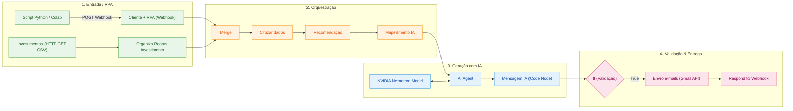

# 🚀 Assistente de Investimentos com RPA, n8n e IA Generativa (NVIDIA Nemotron)

## 📝 Descrição do Projeto

Este projeto consiste em um pipeline de automação inteligente e ponta a ponta para perfilamento de investimentos e comunicação personalizada com clientes. 

A solução combina técnicas de **RPA em Python** para extração de dados, um workflow orquestrado no **n8n (Self-Hosted via Docker)**, processamento avançado de linguagem natural com **Agente de IA (NVIDIA Nemotron)** e envio automatizado de e-mails via **Gmail API (OAuth2)** através de um túnel seguro **Cloudflare**.

---

## 🎯 Objetivos Concluídos (Desafio Completo)

- [x] **RPA / Coleta de Dados:** Script em Python (Google Colab) que lê a tabela de clientes fictícios e envia os dados normalizados via Webhook HTTP POST.
- [x] **Orquestração no n8n:** Leitura do CSV de opções de investimentos, cruzamento de perfis (*Conservador, Moderado e Arrojado*) e mapeamento de contexto.
- [x] **IA Generativa / Agente de IA:** Utilização do nó **AI Agent** conectado ao modelo **NVIDIA Nemotron Chat Model** para geração dinâmica de sugestões personalizadas, tom de voz adequado e formatação clara.
- [x] **Normalização de Saída:** Nós de código em JavaScript para conversão de Markdown para HTML e preparação dos e-mails.
- [x] **Entrega por E-mail:** Envio automatizado de mensagens personalizadas via **Gmail API** e resposta síncrona ao Webhook.
- [x] **Segurança e Infraestrutura:** Exposição segura via **Cloudflare Tunnel** (`trycloudflare.com`) e autenticação **OAuth2** no Google Cloud Console.

---

## 🏗️ Arquitetura do Workflow no n8n



---

## 🛠️ Tecnologias e Ferramentas Utilizadas

| Etapa | Ferramenta | Descrição |
|-------|-----------|-----------|
| **Extração (RPA)** | Python + BeautifulSoup (Google Colab) | Extração web scraping da tabela de clientes e disparo do Webhook. |
| **Orquestração** | n8n (Self-Hosted Docker) | Gerenciamento de fluxo de dados, cruzamento de informações e regras de negócio. |
| **Infraestrutura / Túnel** | Cloudflare Tunnel (`cloudflared`) | Exposição segura da instância n8n local para recebimento de Webhooks e validação do OAuth2. |
| **Modelo de IA** | NVIDIA Nemotron Chat Model | Modelo LLM integrado via AI Agent para criação de mensagens altamente personalizadas. |
| **Envio de Mensagens** | Gmail API (OAuth2) | Envio dos e-mails estruturados em HTML diretamente para as caixas dos clientes. |

---

## 📂 Estrutura do Repositório

```text
.
├── README.md                      # Documentação técnica do desafio
├── n8n/
│   └── workflow.json              # Workflow completo exportado do n8n
├── src/
│   └── extrair_clientes.ipynb     # Notebook de extração RPA e disparo do Webhook
├── prints/                        # Evidências e capturas de tela do fluxo em execução
└── docs/
    ├── index.html                 # Página simulada de clientes
    └── data.csv                   # Opções de investimento por perfil
```

---

## ⚙️ Decisões Técnicas e Aprendizados

1. **Gestão do Callback OAuth2 com Túnel:** A utilização do Cloudflare Tunnel exigiu o alinhamento estrito da variável `WEBHOOK_URL` no arquivo de ambiente do n8n para casar perfeitamente com as *Authorized Redirect URIs* do Google Cloud Console, evitando o erro `redirect_uri_mismatch`.
2. **Normalização Pré e Pós-IA:** Criou-se um nó JavaScript pré-IA para mapear os campos de entrada (`nome`, `saldo`, `perfil`) no prompt, e um pós-IA para formatar a resposta retornada pelo agente de Markdown para tags HTML sanitizadas (`<br>`, `<strong>`), adequando o texto para envio por e-mail.
3. **Escopos Reduzidos no Google Cloud:** Para garantir boas práticas de segurança, configurou-se apenas o escopo estritamente necessário para envio e gerenciamento de e-mails da conta autorizada.

---

## 📸 Evidências de Funcionamento

As capturas de tela demonstrando a execução de ponta a ponta (recebimento dos dados via Webhook, processamento no Agente NVIDIA e envio dos e-mails) encontram-se salvas no diretório `/prints`.